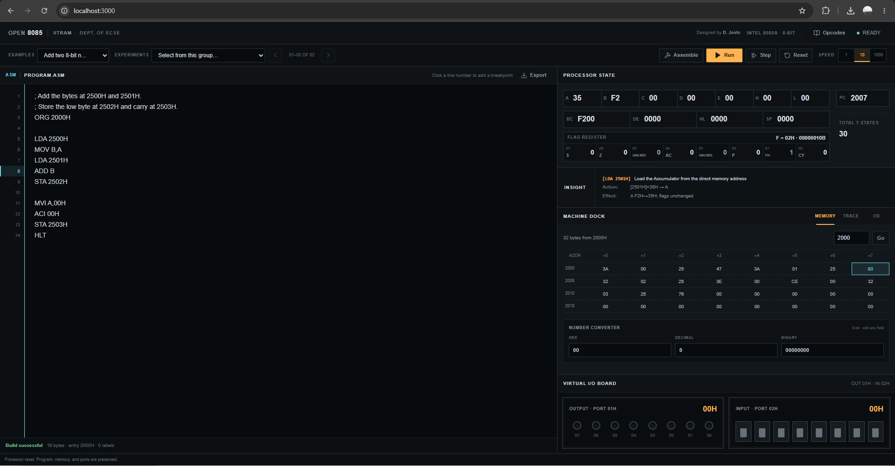

# Open8085 Lab

Designed by **D. Joshi**

A browser-based Intel 8085 programming laboratory for writing, assembling,
running, debugging, and studying assembly-language programs without installing
a desktop simulator.



## Table of contents

- [Overview](#overview)
- [Main features](#main-features)
- [Typical uses](#typical-uses)
- [Quick start](#quick-start)
- [How to use the simulator](#how-to-use-the-simulator)
- [Workspace reference](#workspace-reference)
- [Keyboard shortcuts](#keyboard-shortcuts)
- [Assembler syntax](#assembler-syntax)
- [Solved examples](#solved-examples)
- [Publishing weekly experiments](#publishing-weekly-experiments)
- [Virtual I/O board](#virtual-io-board)
- [Number converter](#number-converter)
- [Autosave and ASM export](#autosave-and-asm-export)
- [Project structure](#project-structure)
- [Development commands](#development-commands)
- [Testing](#testing)
- [Production build](#production-build)
- [Privacy and security](#privacy-and-security)
- [Known limitations](#known-limitations)
- [Troubleshooting](#troubleshooting)
- [Contributing](#contributing)
- [Attribution](#attribution)
- [License](#license)

## Overview

Open8085 Lab combines an 8085 CPU emulator, a two-pass assembler, a source-code
editor, debugging controls, memory and port inspection, and a virtual trainer
board in one responsive web application.

It is designed for:

- Classroom demonstrations
- Weekly laboratory exercises
- Student practice and practical examinations
- Learning registers, flags, memory, stack, branching, and I/O
- Testing small 8085 programs before using physical trainer hardware
- Sharing a controlled experiment list without publishing solutions

The simulator runs locally in the browser. It does not require a database,
student account, or server-side storage.

## Main features

| Area | Capability |
| --- | --- |
| CPU | Intel 8085 register, flag, memory, stack, I/O, interrupt-control, and execution behavior |
| Assembler | Two-pass assembly with labels, symbols, expressions, and line-specific errors |
| Instructions | 80 mnemonics covering data transfer, arithmetic, logic, branching, stack, I/O, and machine control |
| Execution | Assemble, run, pause, single-step, reset, and selectable execution speed |
| Speeds | 1, 10, or 1,000 instructions per second |
| Debugging | Source-line breakpoints, current-line indication, disassembly, T-state counts, and instruction trace |
| Insight | Deterministic three-line explanation of the latest completed instruction using its actual operands and effects |
| Registers | Editable A, B, C, D, E, H, L, BC, DE, HL, SP, and PC values |
| Flags | Canonical 8-bit F register with synchronized hexadecimal/binary values and all D7–D0 positions |
| Memory | 64 KiB address space with a 32-byte editable inspector |
| I/O | 256 byte-wide ports with direct inspection and editing |
| Trainer board | Eight output LEDs on port `01H` and eight input switches on port `02H` |
| Converter | Editable 8-bit hexadecimal, decimal, and binary conversion |
| Examples | Four solved programs with prepared memory or port data |
| Experiments | Number-and-aim-only catalog, ten experiments per page |
| Export | Download the current source as an `.asm` file |
| Persistence | Device-local automatic source recovery |
| Reference | Searchable instruction reference inside the simulator |
| Accessibility | Keyboard controls, visible focus states, labels, and reduced-motion support |

## Typical uses

### For students

- Write and test an ALP before a laboratory session.
- Observe how every instruction changes registers, flags, memory, and T-states.
- Use single-step mode to understand loops and subroutines.
- Enter input data through memory or virtual switches.
- Record final results from memory, registers, or output LEDs.
- Export the completed program as an ASM file for submission.

### For instructors

- Demonstrate 8085 instructions without requiring physical hardware.
- Publish only the current week's experiment aims.
- Keep solved examples separate from unsolved laboratory experiments.
- Use breakpoints and traces to explain program flow.
- Verify I/O programs through virtual LEDs and DIP switches.
- Update the complete experiment catalog by editing one JSON file.

## Quick start

### Requirements

- [Node.js](https://nodejs.org/) `22.13.0` or newer
- npm, included with Node.js
- A modern browser

### Install and run

```bash
git clone <repository-url>
cd open8085-lab
npm ci
npm run dev
```

Open:

```text
http://localhost:3000/
```

The development server supports hot reload, so saved source changes appear
without restarting it.

## How to use the simulator

### 1. Choose the type of program

Use one of the two selectors at the top:

- **Examples** loads a complete solved program and its prepared test data.
- **Experiments** loads only the selected experiment number and title as ASM
  comments. The student must write the complete solution.

The experiment arrows move through groups of ten. Changing the experiment page
does not replace the current editor program.

### 2. Write or edit ASM source

Type directly in the central editor. The default origin is `2000H` unless the
source uses an `ORG` directive.

The editor supports:

- Labels
- Comments beginning with `;`
- Tab insertion
- Line numbers
- Breakpoints
- Automatic local recovery

### 3. Assemble

Select **Assemble** or press `Ctrl+Enter`.

Successful assembly:

- Converts source into machine-code bytes
- Loads the program into simulated memory
- Sets PC to the first instruction in source order
- Clears the previous execution trace
- Loads prepared memory data for solved examples

The lowest emitted address remains the assembly origin used for the memory
image. It may differ from the execution entry when a lower-address data segment
is declared with another `ORG`.

For unsolved experiments, assembling starts with a cleared simulated machine.
Set any required test data after assembly, or write initialization instructions
inside the program.

If assembly fails, the error panel shows the affected source line. Select an
error to jump to that line.

### 4. Run, pause, or step

- **Run** executes continuously.
- **Pause** stops continuous execution without discarding machine state.
- **Step** executes exactly one instruction.
- **Reset** resets the processor registers and returns PC to the execution entry
  while preserving the loaded program, memory, and ports.

Run and Step automatically attempt to assemble source that has changed.
After `HLT`, final machine state is preserved; select Reset before stepping or
running the same assembled program again.

### 5. Inspect the result

Use the right-hand workstation:

- **Processor state** for registers, flags, PC, and T-states
- **Insight** for the purpose, actual action, and verified effect of the latest completed instruction
- **Memory** for editable memory bytes
- **Trace** for recent instructions
- **I/O** for direct port inspection and writing
- **Virtual I/O board** for LEDs and switches

### 6. Export the program

Select **Export** to download an ASM file.

For experiments, the filename is generated safely from the experiment number,
for example:

```text
EXP01.asm
```

The required experiment number and title header is restored automatically if
it was changed or removed before export.

## Workspace reference

### Top bar

Displays:

- Open8085 branding
- IITRAM and Department of ECSE identification
- Author credit
- Intel 8085 equipment identification
- Opcode-reference button
- Current simulator status

### Command bar

Contains:

- Solved-example selector
- Experiment selector
- Previous/next experiment-page controls
- Assemble, Run/Pause, Step, and Reset
- Execution speeds: `1`, `10`, and `1000`

### Assembly editor

The editor includes:

- ASM filename
- Modified-source indicator
- Breakpoint-enabled line-number gutter
- Current execution-line highlighting
- Build summary
- Clickable line-specific assembly errors
- ASM export

Select a line number to add or remove a breakpoint. When Run reaches that
instruction address, execution pauses before executing it.

### Processor state

The processor panel displays:

- 8-bit registers: A, B, C, D, E, H, and L
- Register pairs: BC, DE, and HL
- 16-bit registers: SP and PC
- A complete read-only F register in the canonical `S Z 0 AC 0 P 1 CY`
  layout, shown in both hexadecimal and binary
- Total T-states

Editable register fields accept hexadecimal values. Press Enter or move focus
away from a field to apply a change.

The Flag Register heading keeps both representations together:

```text
F = 17H · 00010111B
```

All eight physical bit positions remain visible and appear from D7 to D0:

| Bit | D7 | D6 | D5 | D4 | D3 | D2 | D1 | D0 |
| --- | --- | --- | --- | --- | --- | --- | --- | --- |
| Meaning | S | Z | Unused | AC | Unused | P | Fixed | CY |
| Required value | Flag | Flag | `0` | Flag | `0` | Flag | `1` | Flag |

`D5` and `D3` are unused and always display `0`. `D1` is the fixed 8085 bit and
always displays `1`, so a cleared functional-flag state is
`F = 02H · 00000010B`. Only the functional flags S, Z, AC, P, and CY can receive
the brief instruction-change highlight; unused and fixed bits remain muted and
noninteractive.

### Insight

The persistent three-line Insight panel explains the latest successfully
completed instruction:

1. The instruction and its purpose
2. The actual calculation, data movement, address, port, or control bits used
3. The verified effect on registers, flags, memory, ports, stack, or control
   flow

Insight is generated deterministically from the local CPU state and executed
opcode. It does not use an AI service, network request, or predicted result.
Manual Step updates it immediately. During continuous Run it remains stable and
updates when execution pauses, reaches a breakpoint, halts, or stops.

### Machine dock: Memory

The Memory tab shows four rows of eight bytes, for a total of 32 editable bytes.

- Enter a hexadecimal address and select **Go**.
- The address is aligned to an eight-byte row.
- Edit any byte directly.
- The PC byte is highlighted.
- The SP location is indicated when it appears in the visible range.

### Machine dock: Trace

The trace records recent execution history, including:

- Instruction address
- Machine-code bytes
- Disassembled mnemonic
- Instruction T-states

Use Step with Insight for instruction-by-instruction learning, or Run to collect
a longer trace.

### Machine dock: I/O

The I/O tab can inspect and edit any port from `00H` to `FFH`.

1. Enter the port number.
2. Press Enter or move focus away.
3. Read its current hexadecimal value.
4. Enter a new value in the write field if required.

The decimal equivalent is displayed beside the editable value.

### Instruction reference

Select **Opcodes** to open the searchable instruction drawer. Search by:

- Mnemonic
- Syntax
- Description

Each entry includes opcode information, syntax, description, and T-state data.

## Keyboard shortcuts

| Shortcut | Action |
| --- | --- |
| `Ctrl+Enter` | Assemble the current source |
| `F8` | Run or pause |
| `F10` | Execute one instruction |
| `Shift+F5` | Reset the processor |
| `Escape` | Close the opcode-reference drawer |
| `Tab` in editor | Insert four spaces |
| `Enter` in a numeric field | Apply the value |

Some browsers or operating systems may reserve function keys. The visible
buttons provide the same actions.

## Assembler syntax

### Basic example

```asm
; Add two bytes and store the answer.
ORG 2000H

LDA 2500H
MOV B,A
LDA 2501H
ADD B
STA 2502H
HLT
```

### Labels

```asm
MVI B,05H

LOOP: DCR B
JNZ LOOP
HLT
```

Labels and mnemonics are case-insensitive.

### Supported directives

| Directive | Purpose | Example |
| --- | --- | --- |
| `ORG` | Set the assembly address | `ORG 2000H` |
| `DB` | Emit bytes or strings | `DB 2AH, "ABC"` |
| `DW` | Emit little-endian 16-bit words | `DW 1234H` |
| `DS` | Reserve zero-initialized bytes | `DS 16` |
| `EQU` | Define a named expression | `COUNT EQU 10` |

### Supported values and expressions

The assembler supports:

- Decimal: `42`
- Intel-style hexadecimal: `2AH`
- Leading-zero Intel hexadecimal when the first digit is `A`–`F`: `0FFH`,
  `0DEADH`
- Prefix hexadecimal: `0x2A`
- Prefix binary: `0b101010`
- Percent binary: `%101010`
- Suffix binary: `101010B`
- Character literals: `'A'`
- Current assembly address: `$`
- Symbols and labels
- Parentheses
- Unary and binary `+` and `-`

Tokens beginning with a letter are symbols, so names such as `DEADH` and `FFH`
remain valid labels. Writing `FFH` without defining that symbol produces an
error with a suggestion to use `0FFH` when a hexadecimal value was intended.

Example:

```asm
COUNT EQU 3
ORG 0100H

TABLE: DB "HI", '!', COUNT + 1
WORDS: DW TABLE, 1234H
SPACE: DS COUNT
```

### Instruction groups

The assembler and CPU cover:

- Data transfer
- 8-bit arithmetic
- 16-bit register-pair arithmetic
- Logical operations
- Compare and rotate operations
- Conditional and unconditional jumps
- Conditional and unconditional calls and returns
- Restart instructions
- Stack operations
- Direct and register-indirect memory operations
- Input and output
- Interrupt enable/disable and mask instructions
- Machine-control instructions

Use the in-application Opcode reference for the complete searchable list.

## Solved examples

The Examples selector contains four prepared programs:

| Example | Main learning objective | Prepared result |
| --- | --- | --- |
| Add two 8-bit numbers | Addition and carry handling | Stores low byte and carry in memory |
| Sum an array into a 16-bit result | Array traversal and multi-byte accumulation | Stores a 16-bit sum |
| Copy a block of memory | Register-pair pointers and loops | Copies five prepared bytes |
| BCD up-counter on an output port | DAA, delay loops, subroutines, and OUT | Sends packed BCD values to port `01H` |

Solved-example definitions are stored in:

```text
lib/examples8085.ts
```

Each definition can include:

- Source code
- Difficulty
- Learning objective
- Prepared memory and port data
- Expected result
- Teaching tips

## Publishing weekly experiments

The experiment system intentionally stores **no solution code**. Each entry
contains only:

- Experiment number
- Experiment aim/title

This makes it possible to publish the current exercises without revealing a
complete advance solution list.

### File to edit

```text
lib/lab-experiments.json
```

### Required format

```json
[
  {
    "number": 1,
    "aim": "Write an ALP to multiply two 8-bit data stored at different memory locations."
  },
  {
    "number": 2,
    "aim": "Write an ALP to multiply a 16-bit number by an 8-bit multiplier."
  }
]
```

### Publishing workflow

1. Open `lib/lab-experiments.json`.
2. Add, update, or remove experiment rows.
3. Keep each aim on one line.
4. Run `npm test`.
5. Commit the JSON change.
6. Push it to GitHub.
7. Rebuild or redeploy the site.

### Validation rules

The build rejects an invalid experiment catalog. Guardrails include:

- The root must be a JSON array.
- At least one experiment is required.
- At most 200 experiments are supported.
- Only `number` and `aim` fields are allowed.
- Numbers must be whole numbers from 1 to 999.
- Experiment numbers must be unique.
- Aims must be non-empty text.
- Aims must be unique after case and whitespace normalization.
- Aims must remain on one line.
- Control characters are rejected.
- Each aim is limited to 300 characters.
- Entries are sorted numerically before display.

Experiment numbering may contain intentional gaps. The interface displays ten
catalog entries per page and supports partial final pages.

### What students receive

Selecting an experiment replaces the editor with:

```asm
; Experiment No: 01
; Title: Write an ALP to ...

```

No algorithm, starter instructions, memory setup, or solved code is included.

If the current editor contains unexported work, the simulator asks for
confirmation before replacing it.

## Virtual I/O board

The virtual trainer board remains visible below the Machine dock.

### Output LEDs

- Port: `01H`
- Instruction: `OUT 01H`
- Width: 8 bits
- Display: D7 through D0

Example:

```asm
MVI A,55H
OUT 01H
HLT
```

This lights alternating output LEDs.

### Input switches

- Port: `02H`
- Instruction: `IN 02H`
- Width: 8 bits
- Controls: D7 through D0

Example:

```asm
IN 02H
STA 2500H
HLT
```

Set the virtual switches before executing `IN 02H`. The switch value is read
into the accumulator and can then be stored or processed.

## Number converter

The Memory tab includes an 8-bit converter with three editable fields:

- Hexadecimal: `00` to `FF`
- Decimal: `0` to `255`
- Binary: `00000000` to `11111111`

Edit any one field and the other two update automatically.

Examples:

| Hex | Decimal | Binary |
| --- | ---: | --- |
| `00` | `0` | `00000000` |
| `0A` | `10` | `00001010` |
| `55` | `85` | `01010101` |
| `FF` | `255` | `11111111` |

Invalid digits, oversized inputs, negative values, and values above one byte
are rejected. Leaving a field restores its normalized value.

## Autosave and ASM export

### Automatic local recovery

The current document and source are stored in browser `localStorage`.

- No source is sent to a database.
- Recovery is specific to the current browser and device.
- Solved examples, experiments, and scratch programs are identified separately.
- An older saved scratch program is not given solved-example memory setup.

If browser policy, private mode, or storage limits block local storage, the
simulator continues to work without persistence.

### Replacement protection

When changing to another example or experiment, edited source is protected by a
confirmation prompt. Export important work before discarding it.

### Export behavior

- Solved examples use a readable example-based filename.
- Scratch programs use `program.asm`.
- Experiments use a number-only filename such as `EXP07.asm`.
- Experiment metadata is normalized before download.
- Student comments and source code are preserved.
- Exported text uses LF line endings.

## Project structure

```text
open8085-lab/
├── app/
│   ├── globals.css              # Workstation UI and responsive styles
│   ├── layout.tsx               # Fonts and page metadata
│   ├── page.tsx                 # Application route
│   └── simulator.tsx            # Simulator UI and interaction layer
├── lib/
│   ├── assembler8085.ts         # Two-pass assembler and instruction metadata
│   ├── byteConverter.ts         # 8-bit HEX/DEC/BIN conversion guards
│   ├── cpu8085.ts               # Intel 8085 execution engine
│   ├── examples8085.ts          # Four solved examples
│   ├── insight8085.ts           # Deterministic per-instruction explanations
│   ├── lab-experiments.json     # Number-and-aim-only experiment catalog
│   └── labExperiments.ts        # Catalog validation, paging, and ASM headers
├── public/
│   └── og.png                   # Project/social preview image
├── tests/
│   ├── byte-converter.test.ts   # Converter validation tests
│   ├── core8085.test.ts         # Assembler and CPU integration tests
│   ├── insight8085.test.ts       # Opcode coverage and Insight semantics
│   ├── lab-experiments.test.ts  # Catalog and export guardrail tests
│   └── rendered-html.test.mjs   # Server-rendered application checks
├── worker/
│   └── index.ts                 # Cloudflare Worker entry
├── package.json
├── vite.config.ts
└── README.md
```

## Development commands

| Command | Purpose |
| --- | --- |
| `npm install` | Install exact project dependencies |
| `npm run dev` | Start the local development server |
| `npm run build` | Create a production build |
| `npm run start` | Start the built application |
| `npm test` | Build and run all automated tests |
| `npm run lint` | Run ESLint |

The project requires Node.js `22.13.0` or newer, as declared in
`package.json`.

## Testing

Run the complete verification suite:

```bash
npm test
```

The test command performs:

1. Production build
2. Assembler tests
3. CPU execution tests
4. Memory, stack, branch, call, return, I/O, and DAA integration tests
5. Experiment-schema and pagination tests
6. Safe experiment-header and filename tests
7. Byte-converter tests
8. Exhaustive opcode and instruction-Insight tests
9. Full 8-bit Flag Register tests
10. Server-rendered page regression tests

Important covered cases include:

- Forward labels and multiple number formats
- Intel-style H-suffix labels and leading-zero hexadecimal diagnostics
- `ORG`, `EQU`, `DB`, `DW`, and `DS`
- Separate image origin and first-instruction execution entry
- Exhaustive subtraction/compare Auxiliary Carry and borrow handling
- Exhaustive `DCR` Auxiliary Carry behavior with Carry preservation
- Five-T-state `HLT` behavior and reset interrupt masks
- Conditional loops
- CALL/RET stack behavior
- Block copying
- IN/OUT behavior
- Packed BCD adjustment
- `RIM`, `SIM`, delayed `EI`, stack/PSW, and conditional-flow explanations
- Canonical F-register values for every functional-flag combination
- Exact D7–D0 order, hexadecimal/binary agreement, and fixed/unused F-register
  bits
- Invalid and malicious experiment data
- Ten-item experiment pagination
- Converter boundaries from 0 to 255
- Required interface sections in rendered HTML

## Production build

Create the optimized build:

```bash
npm run build
```

Run the built application:

```bash
npm run start
```

The project uses Vinext, Vite, and a Cloudflare Worker-compatible output.
Hosting configuration is stored in:

```text
.openai/hosting.json
```

Do not create a second hosting project when an existing project ID is present.
Deployment-specific credentials and runtime values must not be committed to the
repository.

## Privacy and security

- Assembly source remains in the browser unless the user exports or submits it.
- The experiment catalog is a static repository file.
- The simulator does not require a student database.
- There is no application-level student account system.
- Browser storage is used only for local source recovery.
- React renders experiment aims as text; HTML from the catalog is not executed.
- Catalog validation rejects unexpected fields and unsafe control characters.
- Download filenames are derived only from validated experiment numbers.
- No secret keys should be added to source files or JSON experiment data.

Hosted access control, if enabled, is managed by the hosting platform and is
separate from simulator program data.

## Known limitations

- Execution speed is browser-scheduled and is not a cycle-accurate real-time
  clock.
- The three speed settings represent instructions per second, not processor
  frequency.
- The number converter is limited to one byte.
- The experiment catalog is updated through Git and deployment, not a database
  or instructor dashboard.
- Local recovery does not synchronize between devices or browsers.
- Clearing browser site data removes locally recovered source.
- The virtual LEDs and switches model byte-wide ports, not electrical timing or
  physical hardware faults.
- The 32-byte Memory inspector is a window into the full 64 KiB address space,
  not the total memory size.
- The core exposes interrupt masks, pending requests, `RIM`, `SIM`, `EI`, and
  `DI`, but does not yet model full hardware interrupt acceptance or waking a
  halted processor.

## Troubleshooting

### The development server does not start

- Confirm `node --version` is `22.13.0` or newer.
- Run `npm install` again.
- Check whether another program is already using port 3000.

### The program does not run

- Select Assemble and resolve every line-specific error.
- Ensure the source contains at least one executable instruction.
- Check that PC points to the first instruction in source order.
- Ensure the program eventually reaches `HLT` or a breakpoint.
- Reduce speed and use Step to find the problem.
- After `HLT`, select Reset before using Step or Run again.

### Memory data disappears after assembly

Assembly starts a fresh simulated machine. For a custom experiment:

- Assemble first, then enter test data in Memory; or
- Add data initialization instructions/directives to the program.

Solved examples automatically reload their prepared data.

### An experiment update fails the build

Check `lib/lab-experiments.json` for:

- Invalid JSON commas or quotes
- Duplicate numbers
- Duplicate aims
- Extra fields
- Multiline aim text
- Empty aims
- Numbers outside 1–999

Then run:

```bash
npm test
```

### Saved work does not appear on another computer

Autosave is browser-local. Export the ASM file and transfer or submit that file
when work must move between devices.

## Contributing

Contributions should preserve the simulator's educational behavior and avoid
unrelated CPU-engine changes.

Read [CONTRIBUTING.md](CONTRIBUTING.md) before opening a pull request. Security
issues must follow the private reporting process in [SECURITY.md](SECURITY.md)
instead of being posted in a public issue.

### Suggested workflow

1. Create a branch.
2. Make one focused change.
3. Add or update tests.
4. Run `npm test`.
5. Review the interface at desktop and narrow widths.
6. Commit with a clear message.
7. Open a pull request describing the behavior and verification.

### Pull-request checklist

- [ ] CPU or assembler behavior is covered by a test.
- [ ] New controls have accessible labels.
- [ ] Keyboard behavior still works.
- [ ] Memory and I/O values remain byte/word bounded.
- [ ] Experiment data contains no solution code.
- [ ] No secrets or local logs are committed.
- [ ] `npm test` passes.
- [ ] The local page loads successfully.

## Attribution

**Open8085 Lab — IITRAM, Department of ECSE**

Designed by **D. Joshi**

The interface is intended for microprocessor laboratory teaching and student
practice.

## License

Open8085 Lab is licensed under the [MIT License](LICENSE).

Copyright (c) 2026 Mr. D. D. Joshi.
